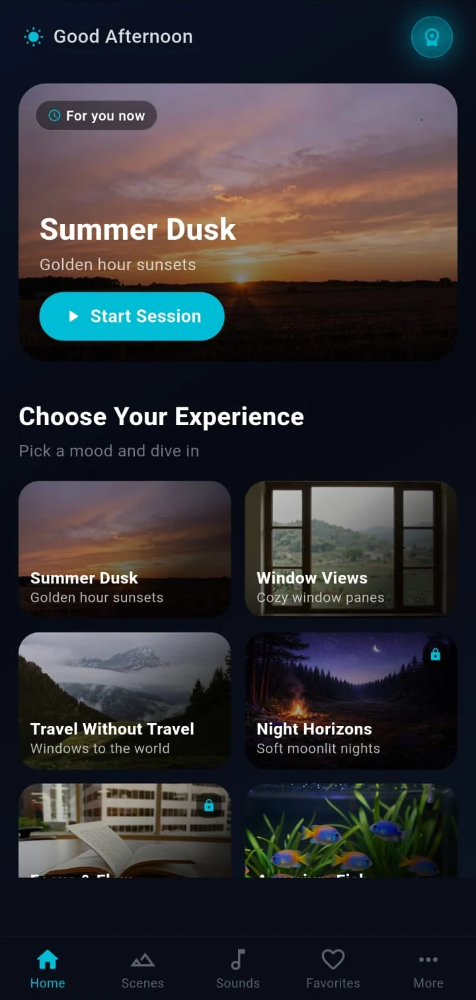
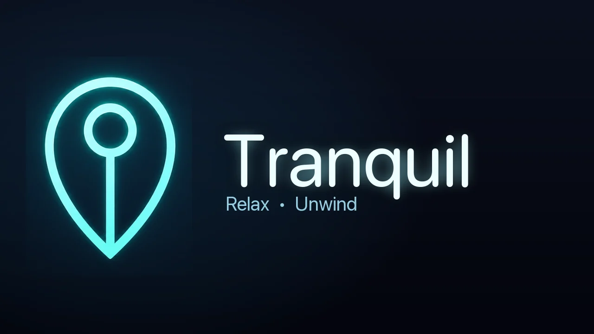
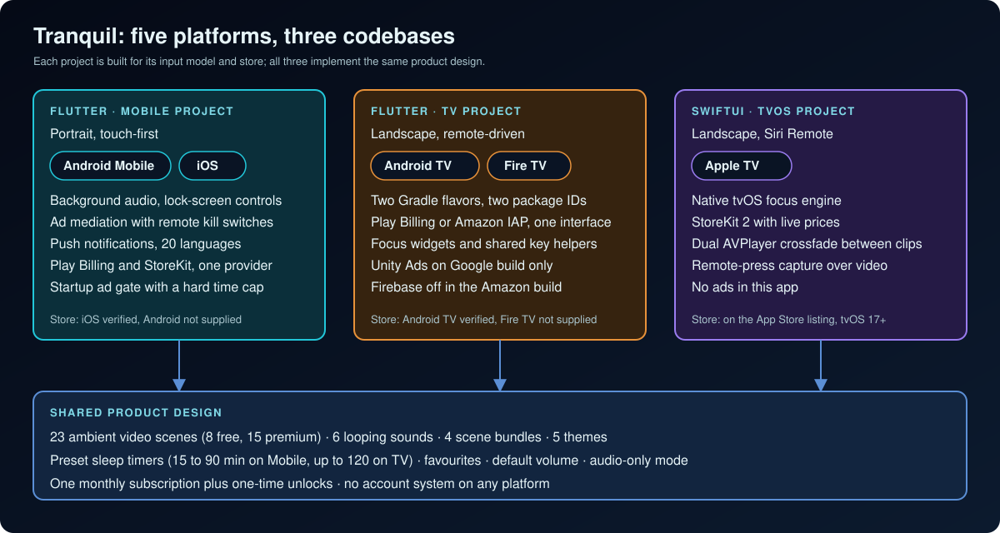
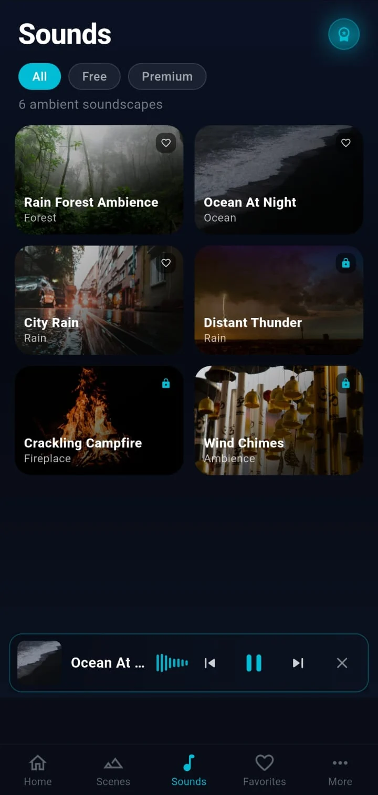
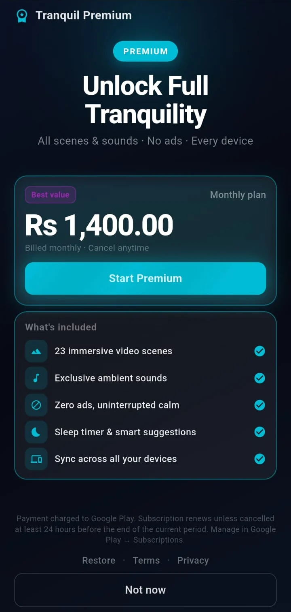
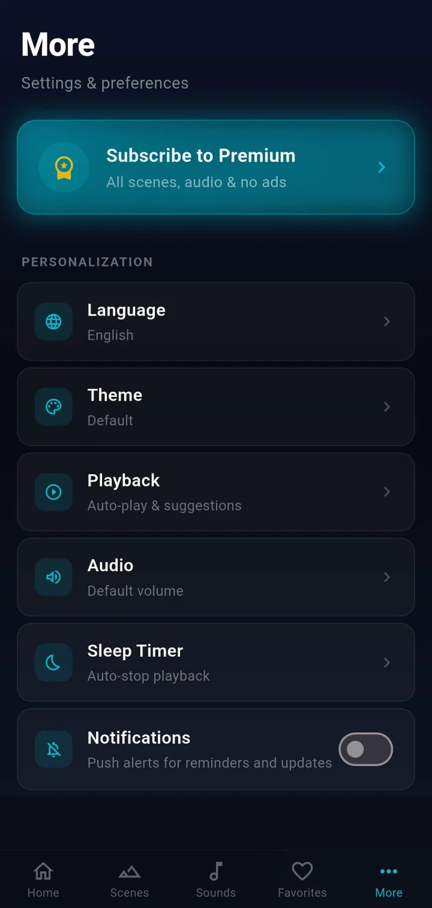
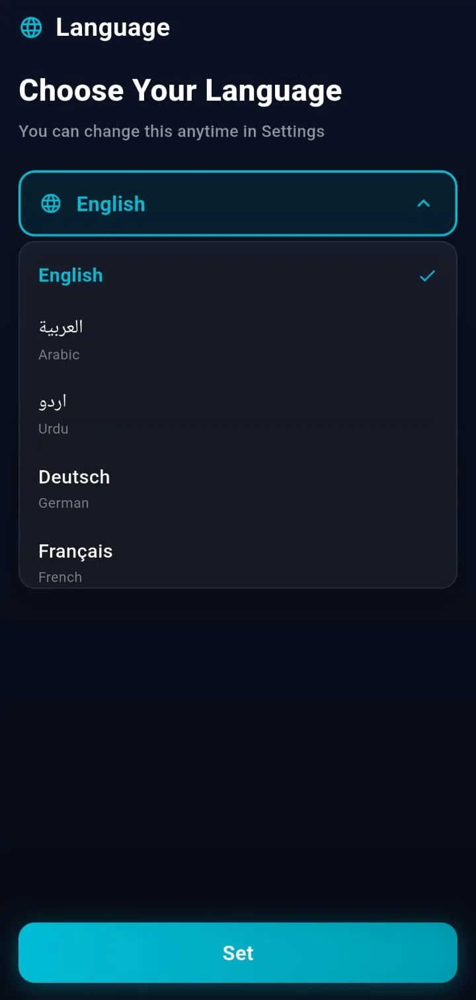
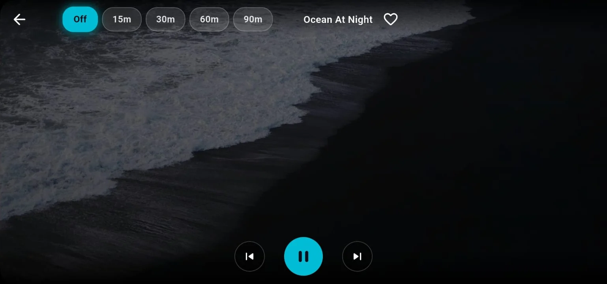
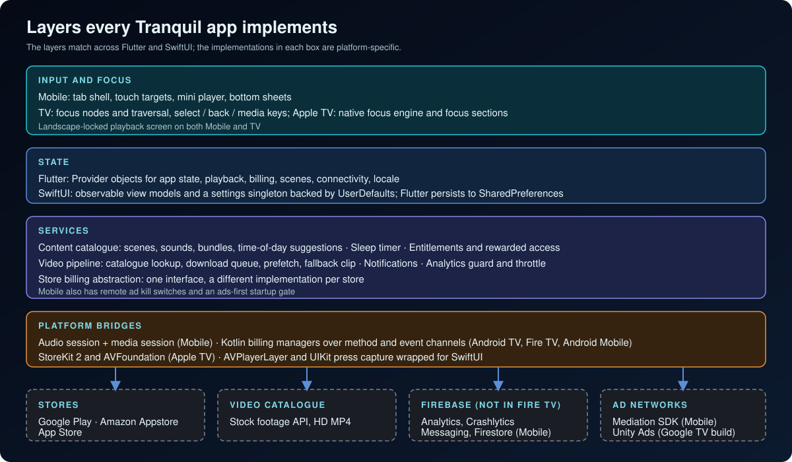
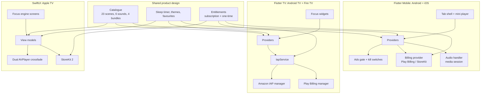

# Tranquil: Sleep & Relax

**An ambient video-and-sound app for sleep, calm and focus, engineered as five platform builds from three codebases: touch-first Mobile, and remote-driven Android TV, Fire TV and Apple TV.**

**Android Mobile · iOS · Android TV · Fire TV · Apple TV** 
Flutter · Dart · SwiftUI · Kotlin · StoreKit 2 · Play Billing · Amazon IAP · Firebase

&nbsp;&nbsp;&nbsp;

 <b>Left:</b> real screenshot of the Mobile app. <b>Right:</b> Fire TV banner artwork (TV artwork, not a screenshot).

---

## Get the App

  
  

The Google Play listing is titled "Tranquil: Sleep & Relax TV" and describes an Android TV app. The App Store listing is titled "Tranquil: Sleep & Relax" and lists iPhone, iPad and Apple TV (tvOS 17 or later) under Compatibility. No store links are shown for Android Mobile or Fire TV because none were verified for this showcase.

## Platform Status

Every platform below was checked against the production projects. A store badge appears only where a listing was supplied and checked.

| Platform | Status | Evidence in the production source | Store listing |
|---|---|---|---|
| **Android Mobile** | Verified build target | Flutter Mobile project with an Android module, media-playback foreground service and Play Billing bridge; the screenshots show Play billing text | Not supplied |
| **iOS** | Verified | Same Mobile project, iPhone and iPad device family, iOS 15 minimum, background-audio mode | Verified on the App Store |
| **Android TV** | Verified | Flutter TV project, `androidtv` flavor, Leanback launcher and banner, touchscreen not required, landscape | Verified on Google Play |
| **Fire TV** | Verified build target | Same TV project, `firetv` flavor with its own package, Leanback-only launcher, Amazon IAP receiver and its own banner | Not supplied |
| **Apple TV** | Verified | Separate native SwiftUI project, tvOS 17 deployment target, tvOS device family, brand assets with top-shelf images | Listed on the App Store |

## Product at a Glance

| | |
|---|---|
| **What it is** | Looping ambient scenes and sleep sounds for winding down, sleeping or background calm |
| **Platforms** | Android Mobile and iOS (one Flutter project), Android TV and Fire TV (one Flutter project, two store flavors), Apple TV (native SwiftUI) |
| **Content** | 23 video scenes (8 free, 15 premium), 6 looping sounds (3 free, 3 premium), 4 scene bundles, 5 colour themes |
| **Playback** | Scenes loop muted stock footage; sounds loop bundled audio; a sleep timer ends the session |
| **Monetisation** | One monthly subscription and 14 one-time unlocks; ads on Mobile and the Google TV build; a rewarded ad grants one hour of access on Mobile |
| **Accounts** | None. There is no sign-in on any platform; purchases are restored from the store |
| **Mobile code** | About 25k lines of hand-written Dart in 122 files, plus a small Kotlin and Swift layer and a forked ad-mediation plugin |
| **TV code** | About 23k lines of Dart in 54 files and about 1.3k lines of Kotlin across the two store flavors |
| **Apple TV code** | About 6.9k lines of Swift in 36 files |
| **Languages** | 20 on Mobile; English on the TV apps |

## Five Platforms, Three Codebases

  

| | Mobile (Android, iOS) | Android TV and Fire TV | Apple TV |
|---|---|---|---|
| **Stack** | Flutter, Dart 3 | Flutter, Dart 3, Kotlin | SwiftUI, StoreKit 2, AVFoundation |
| **Input** | Touch | Remote D-pad, select, back and media keys | Siri Remote and the tvOS focus engine |
| **Orientation** | Portrait; playback locks to landscape | Landscape | Landscape |
| **Navigation** | Five-tab shell with a mini player and bottom sheets | Focus nodes and shared focus widgets | Native focus with focus sections and default-focus hints |
| **Background audio** | Media session, lock-screen controls, interruption handling | No media session; playback runs in the foreground screen | No audio-session setup in code |
| **Billing** | Play Billing and StoreKit behind one provider | Play Billing (Android TV) or Amazon IAP (Fire TV) behind one interface | StoreKit 2 |
| **Ads** | Ad mediation with remote kill switches | Unity Ads on the Google build; none on Fire TV | None |
| **Telemetry** | Firebase Analytics through a validating layer | Firebase on the Google build only, throttled focus events | Console logging in debug; no analytics SDK |
| **Sleep timer end** | Pause, dim, leave the app | Pause, attempt a native TV sleep, fall back to leaving the app | Pause, fade to black, return to the previous screen |

Full comparison: [docs/PLATFORM_ENGINEERING.md](docs/PLATFORM_ENGINEERING.md).

## Live Product Showcase (Mobile)

Real screenshots captured on an Android phone running the Mobile app. System status bars were removed.

<table>
  <tr>
    <td align="center"> <b>Home</b> Time-based suggestion</td>
    <td align="center"> <b>Sounds</b> Mini player, locked items</td>
    <td align="center"> <b>Bundle sheet</b> Buy, subscribe or watch an ad</td>
    <td align="center"> <b>Premium</b> Monthly plan</td>
  </tr>
  <tr>
    <td align="center"> <b>More</b> Preferences</td>
    <td align="center"> <b>Language</b> 20 choices</td>
    <td align="center" colspan="2"> <b>Playback</b> Landscape, sleep timer, favourite</td>
  </tr>
</table>

## TV Artwork

No TV screenshots are included. The images below are production artwork from the TV projects and are labelled as artwork, not screenshots.

<table>
  <tr>
    <td align="center"> <b>Android TV banner</b> TV artwork (not a screenshot)</td>
    <td align="center"> <b>Fire TV banner</b> TV artwork (not a screenshot)</td>
    <td align="center"> <b>Apple TV top shelf</b> TV artwork (not a screenshot)</td>
  </tr>
</table>

## Key Features

- **Scenes.** 23 looping video scenes in named categories, played muted at HD from a stock-footage catalogue, with a bundled clip covering any gap.
- **Sounds.** Six looping audio soundscapes bundled in the app, with a mini player and lock-screen controls on Mobile.
- **Sleep timer.** Preset durations, a saved default, a countdown badge, and a platform-specific end action.
- **Time-aware home.** Mobile reorders its experience grid by time of day; TV apps add scheduled mood blocks that launch a matching scene.
- **Premium model.** A monthly subscription, scene and sound unlocks, four bundles, and on Mobile a rewarded ad for one hour of access.
- **Favourites, themes and audio-only mode.** Five themes, saved favourites, a default volume and a dimmed screen for audio-only listening.
- **Localisation.** 20 interface languages on Mobile, including right-to-left scripts.
- **Remote-first TV.** Every control reachable by remote, with visible focus states and shared key handling.

## Engineering Highlights

### One product on five platforms, three codebases
- **Problem:** phones, Android-based TV sticks, Fire TV and Apple TV differ in input, store rules, billing and what the OS allows an app to do. One shared codebase would force the weakest common denominator; five separate ones would drift.
- **Approach:** three projects split on the real fault lines. One Flutter project for touch platforms, one Flutter project for Android-based TV with store flavors, and a native SwiftUI project where the platform's focus and video APIs matter. The catalogue, tiers, themes and timer semantics are kept equivalent across all three.
- **Outcome:** each platform uses its native input and billing model while the product stays recognisably the same.

### One TV codebase, two stores
- **Problem:** Amazon's review rejects apps that reference Play Billing classes or declare a phone launcher, while Google Play needs Play Billing and Firebase.
- **Approach:** two Gradle flavors with their own package IDs. Play Billing and Play-services dependencies are attached to the Google flavor only, the Fire TV manifest strips the phone launcher filter and declares the Amazon receiver, and Firebase plugins are applied only for Google builds because their generated initialiser runs before Dart code. A single `IapService` interface hides the two billing managers, and a test checks the store-specific product mapping.
- **Outcome:** one Dart codebase produces two store builds with different billing, ads and telemetry.

### Never a black frame behind the UI
- **Problem:** scene video comes from a remote catalogue, so the first clip may take seconds, a download may fail, and the next clip may not be ready when the current one ends.
- **Approach:** a bundled clip loops the instant a scene opens; clips download through a priority queue into temporary files that are renamed on completion; the next clip is prefetched; and if it is not ready the current clip loops and the prefetch is retried. Apple TV streams clips instead and crossfades between two players.
- **Outcome:** playback degrades to a looping clip rather than an empty screen.

### Focus that a remote can drive
- **Problem:** a D-pad cannot point; every control needs predictable focus, a visible state and the same activation keys, and a TV may crop the screen edges.
- **Approach:** shared focus widgets handle select, enter, numpad enter and space; a tested overscan-safe wrapper widget is available for edge-safe layouts; scroll-into-view only moves the page when a card is not already visible, which avoids a jerk on every sideways move. On Apple TV, focus is grouped into focus sections with default-focus hints, and a UIKit bridge captures remote presses while a video player would otherwise take focus.
- **Outcome:** the same screens can be driven end to end by a remote on Android TV, Fire TV and Apple TV, with unit tests for the focus helpers, the button and the safe-area widget on Android TV.

### Ads that cannot trap a launch
- **Problem:** an app-open ad before the first screen risks holding users, or a store reviewer, on a splash.
- **Approach:** the Mobile startup gate races the ad flow against a hard cap of 22 seconds on Android and 26 on iOS, enforces a two-second minimum splash, skips for premium users and when offline, and resolves exactly once. Seven ad placements can be switched off remotely; a missing field or an unreadable config leaves ads **enabled**, so a console outage does not change normal behaviour.
- **Outcome:** the launch always completes, and operations can disable a placement without a release.

### Audio that respects the OS
- **Problem:** a sleep app plays for hours with the screen off while calls, headphones and other apps compete for the audio session.
- **Approach:** one player is bridged to the OS media session. An interruption pauses playback and resumes it only if the user had not paused; unplugging headphones pauses; lock-screen skip buttons route through entitlement-aware navigation so they never land on a locked sound.
- **Outcome:** background playback and lock-screen controls behave like a native media app on Mobile.

More: [docs/ENGINEERING_CHALLENGES.md](docs/ENGINEERING_CHALLENGES.md).

## Architecture

  

Details: [docs/ARCHITECTURE.md](docs/ARCHITECTURE.md).

## Technology Stack

| Layer | Mobile | Android TV / Fire TV | Apple TV |
|---|---|---|---|
| App | Flutter / Dart 3 | Flutter / Dart 3 | SwiftUI, tvOS 17+ |
| State | `provider` | `provider` | Observable view models, singleton settings |
| Persistence | `shared_preferences` | `shared_preferences` | `UserDefaults` |
| Audio | `just_audio`, `audio_service`, `audio_session` | `just_audio` | `AVPlayer` |
| Video | `video_player` with an on-disk clip cache | `video_player` with an on-disk clip cache | `AVPlayer` pair with `AVPlayerLayer` crossfade |
| Billing | `in_app_purchase` plus a Kotlin bridge on Android | Kotlin Play Billing manager or Kotlin Amazon manager | StoreKit 2 |
| Ads | Ad-mediation SDK (forked plugin) | Unity Ads on Google build | None |
| Firebase | Core, Analytics, Crashlytics, Messaging, Performance, Firestore | Core, Analytics, Crashlytics (Google build) | None |
| Notifications | FCM and local notifications | None | None |
| Localisation | Generated, 20 languages | English | English |
| Tests | 2 Dart test files, 1 iOS placeholder | 10 Dart test files, device-smoke flows (Maestro, Appium) | None in the repository |

## Documentation

| Read | For |
|---|---|
| [Platform engineering](docs/PLATFORM_ENGINEERING.md) | Mobile vs Android TV vs Fire TV vs Apple TV, what is verified |
| [Technical case study](docs/TECHNICAL_CASE_STUDY.md) | End-to-end write-up |
| [Architecture](docs/ARCHITECTURE.md) | Layers, flows and diagrams |
| [Engineering challenges](docs/ENGINEERING_CHALLENGES.md) | Problem, context, approach, trade-offs, outcome |
| [Product overview](docs/PRODUCT_OVERVIEW.md) | Content, screens and the premium model |
| [Privacy and source](docs/PRIVACY_AND_SOURCE.md) | What is and is not published |

## Source Code

This repository is a portfolio showcase for a production application. Production source code is maintained privately. See [RIGHTS.md](RIGHTS.md) for usage terms.
