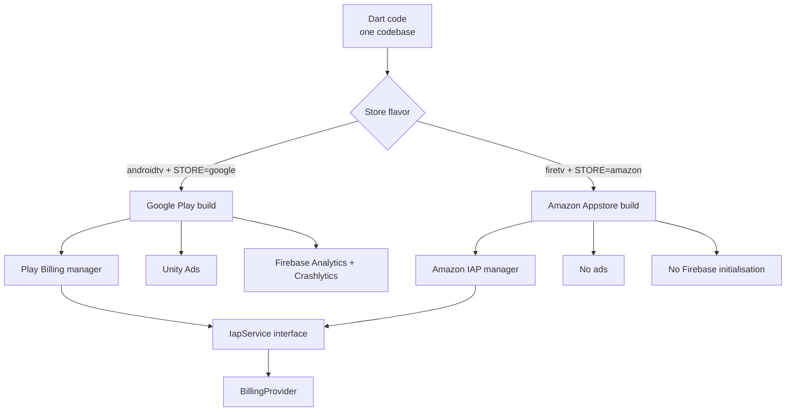
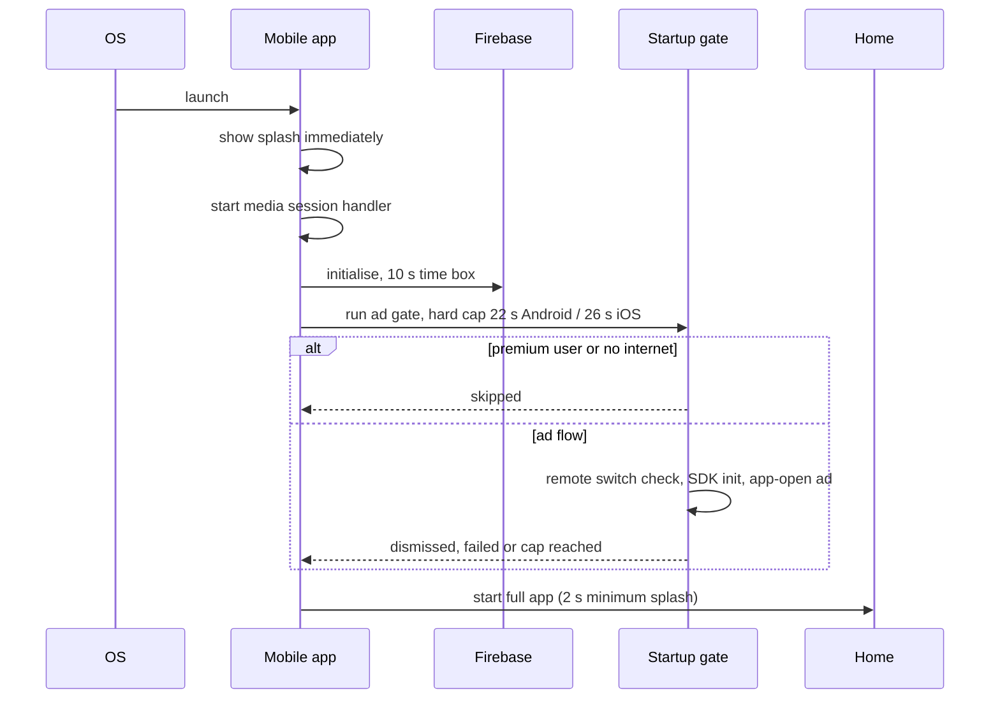
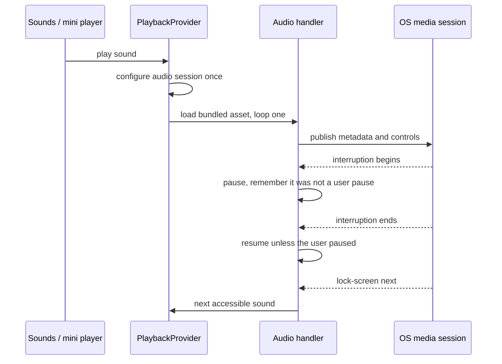
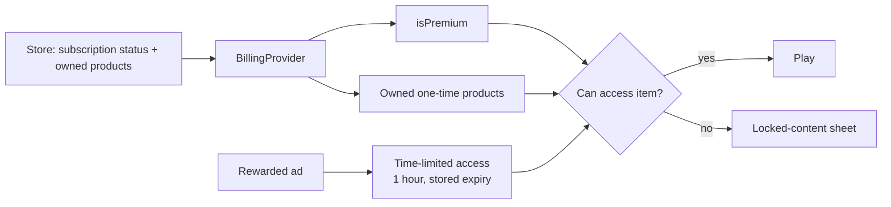

# Architecture

Three production projects implement one product: a Flutter Mobile project (Android Mobile and iOS), a Flutter TV project (Android TV and Fire TV flavors) and a native SwiftUI tvOS project (Apple TV). This document describes the structure they share, where they diverge, and the main runtime flows. Names are conceptual; they do not match production identifiers.

  

## Layers

| Layer | Responsibility | Flutter apps | Apple TV |
|---|---|---|---|
| Input and focus | Turn touch or remote input into intent | Tab shell and gestures (Mobile); focus widgets and key helpers (TV) | SwiftUI focus engine, focus sections, press-capture bridge |
| State | Hold UI-relevant state and notify | `provider` objects: app state, playback, billing, scenes, connectivity, locale (Mobile only) | Observable view models and a settings singleton |
| Services | Domain logic without UI | Catalogue, packs, sleep timer, scheduled moods (TV), rewarded access, analytics, notifications (Mobile) | Scene and audio catalogue, scheduled moods, StoreKit service, playlist service |
| Platform bridges | Reach OS and store APIs | Audio handler, Kotlin billing managers over channels, Swift splash (iOS) | StoreKit 2, AVFoundation, a UIKit press bridge |
| External | Systems the app talks to | Stores, a stock-footage catalogue API, Firebase, ad networks | App Store, stock-footage API |

## Build-time structure of the TV project

Two inputs select a build: a Gradle product flavor, which chooses the application ID, manifest and native sources, and a compile-time `STORE` value that the Dart code reads to pick the billing service and to switch ads and Firebase on or off. The Firebase Gradle plugins are applied only when an Android TV task is requested, because the code they generate runs before Dart starts.

## Startup flows

The TV Flutter app is simpler: it records a session, locks landscape, shows a splash with a short fade, and then starts the app; ad SDK start-up for the Google build is dispatched in the background after the first frame. The Apple TV app shows a splash for about a second and a half, asks for tracking permission, and moves to the home screen.

## Scene playback flow

  

1. The playback screen opens and immediately loops a bundled fallback clip.
2. The scene's category maps to a playlist of catalogue clip IDs held in the app.
3. A catalogue lookup returns HD MP4 renditions; a priority queue downloads one into a temporary file and renames it on success.
4. The cached clip replaces the fallback, muted, and the next clip is prefetched at a lower priority.
5. When a clip ends, the next one starts; if it is not ready the current clip loops and the prefetch retries.
6. On Apple TV the same idea streams clips and crossfades between two players for 1.2 seconds.

## Sound playback flow (Mobile)

The skip routing asks the entitlement layer for the next sound the user can actually play, so a lock-screen button never opens a locked item.

## Entitlements

- The subscription flag is derived from store status only; one-time purchases never set it.
- After the first store sync in a session, access checks consult the store rather than a local copy.
- Rewarded access is stored per category, bundle or sound with an expiry time and cached in memory so lock chips update at once.
- When premium lapses, premium favourites are removed from the saved list.
- Purchase buttons check connectivity first and show a message instead of starting a flow that cannot finish.

## Remote configuration (Mobile)

A single Firestore document holds a boolean per ad placement (app-open, in-app interstitial, home banner, language-screen native ad, and three rewarded placements). A listener applies changes live.

**Defaults.** Every placement starts enabled. A missing document, a missing field, a non-boolean value, a timed-out first read (5 seconds) or a listener error all leave the affected placement **enabled**. The system therefore fails open for ads: remote configuration can only switch placements off, never on. When a placement is off, the code reports completion or failure to the caller so the user flow continues.

The TV and Apple TV projects have no remote configuration.

## Persistence

| Platform | Store | What |
|---|---|---|
| Mobile and TV Flutter | `shared_preferences` | Premium flag, favourites, theme, default volume, default sleep timer, audio-only and dim settings, last played content, pack category choices, rewarded-access expiries, locale (Mobile), scheduled mood blocks (TV) |
| Mobile | App documents folder | Cached video clips (temporary files renamed on completion) |
| Apple TV | `UserDefaults` | Premium flag, theme, default volume, default sleep timer, favourites, last played, scheduled moods |

There is no user database and no cloud copy of user data. The only server-side data the Mobile app writes is an anonymous push registration.

## Analytics and crash reporting

- **Mobile.** Events pass through a validating layer: reserved Firebase event and parameter names are remapped rather than dropped, parameters are bounded in count and length, free-text fields are stripped, and events queue in memory (bounded at 500) until the dispatcher is ready.
- **Android TV.** A similar guard renames reserved names, strips sensitive parameter names and caps values at 100 characters. A throttle drops repeated focus events within 350 ms.
- **Fire TV.** Analytics and crash reporting are no-ops by design.
- **Apple TV.** An analytics facade logs to the console in debug builds; no analytics SDK is integrated.
