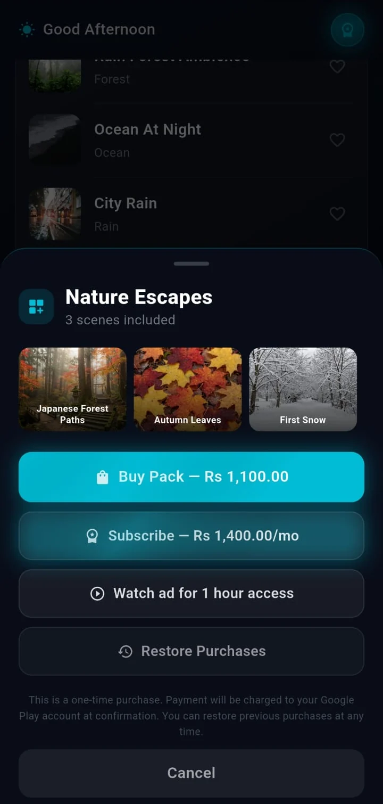

# Engineering Challenges

Eight problems that stand out across the three production projects. Outcomes describe observable behaviour in the code; no metrics are claimed.

<table>
  <tr>
    <td align="center"> Real Mobile screenshot</td>
    <td align="center"> Android TV banner artwork (not a screenshot)</td>
  </tr>
</table>

---

## 1. Five platforms without five codebases or one lowest-common-denominator app

**Problem**
Touch phones, Android-based TV devices, Fire TV and Apple TV differ in input, store policy, billing and OS capabilities.

**Context**
The Android TV app came first; a Mobile Flutter project and a native tvOS project followed.

**Engineering approach**
Three projects split along real differences: Flutter for touch platforms, Flutter with store flavors for Android-based TV, and SwiftUI where the native focus engine and video APIs matter. The catalogue, tiers, themes and timer semantics were kept equivalent.

**Trade-offs**
There is no shared package, so catalogue and rule changes must be made three times, and the projects have already diverged (for example sleep-timer presets, audio handling and analytics).

**Outcome**
Each platform uses its own input and billing model while staying recognisably one product. A shared domain package would be the next step.

---

## 2. One TV codebase for two stores

**Problem**
Google Play needs Play Billing and Firebase. Amazon's review rejects Play Billing references and phone launcher entries, and Fire TV purchases need an Amazon listener registered with a live activity.

**Context**
Both TV targets share a Dart codebase and an application ID base.

**Engineering approach**
Two Gradle flavors with different application IDs. Play Billing and Play-services libraries are attached to the Google flavor only; the Fire TV manifest strips inherited launcher filters and adds the Amazon receiver and package queries; the Firebase plugins are applied only for Google tasks because their generated start-up code runs before Dart. A compile-time store value switches ads, analytics and billing in Dart, behind one billing interface.

**Trade-offs**
Build-time branching adds configuration to maintain, and a mis-set store value would select the wrong behaviour; a configuration test and a release audit script guard this.

**Outcome**
One Dart codebase produces two store builds with different billing, ads and telemetry.

---

## 3. Never an empty screen behind the controls

**Problem**
Scene video comes from a remote catalogue. The first clip can be slow, a download can fail, and the next clip may not be ready when the current one ends.

**Context**
Scenes are the core experience and are often left running for hours.

**Engineering approach**
A bundled clip loops at once; clips download through a priority queue into temporary files renamed on completion; the next clip is prefetched; if it is not ready the current clip loops and the prefetch retries. On Mobile the previous controller stays on screen while the next initialises. On Apple TV two muted players crossfade for 1.2 seconds.

**Trade-offs**
Clips are cached on disk (Mobile) and the playlist is embedded in the app, so changing content needs a release.

**Outcome**
Failures degrade to a looping clip rather than a blank or flashing screen.

---

## 4. Focus that a remote can drive

**Problem**
A D-pad cannot point. Controls need predictable focus, a visible state, consistent activation keys and handling of media keys the embedding does not forward.

**Context**
Flutter TV screens are large, scrolling rows of cards; Apple TV already has a focus engine whose default effects did not match the design.

**Engineering approach**
Shared helpers classify directional, select-like and back-like keys; focus-aware buttons wrap activation; scroll-into-view runs only when a card is not already visible; the Android TV activity re-injects media play and pause as a select event. On Apple TV, system effects are disabled in favour of a custom scale, border and glow, controls are grouped into focus sections with default-focus hints, and a UIKit bridge reports remote presses while video holds focus.

**Trade-offs**
Custom focus visuals must be kept consistent across widgets, and some screens still use their own focus code rather than the shared wrappers.

**Outcome**
The screens can be driven end to end with a remote, with unit tests covering the key helpers, the button and the safe-area widget on Android TV.

---

## 5. Telemetry that does not flood or leak

**Problem**
Scanning a card row generates a focus event per key press, and analytics services reject reserved names and have size limits. Free-text such as titles or error messages should not be sent.

**Context**
Mobile and Android TV both send Firebase Analytics events.

**Engineering approach**
Both validate event and parameter names, remapping reserved ones instead of dropping them, cap parameter counts and lengths, and strip free-text parameter names. Android TV also throttles repeated focus events within 350 ms while keeping direction changes. Mobile queues events in memory (bounded at 500) until the dispatcher is ready. Fire TV disables analytics and crash reporting entirely.

**Trade-offs**
Throttling loses fine-grained navigation data, and renaming events changes how they appear in reports.

**Outcome**
Bounded, name-safe events, with unit tests for the validators.

---

## 6. A launch that an ad cannot hold hostage

**Problem**
An app-open ad before the first screen can hold a user, or a store reviewer, on a splash screen.

**Context**
Mobile uses ad mediation with several networks and an iOS tracking prompt.

**Engineering approach**
A startup coordinator races the ad flow against a hard cap (22 seconds on Android, 26 on iOS), enforces a two-second minimum splash, skips for premium users and offline launches, and resolves exactly once. Firebase start is time-boxed to 10 seconds after a stall was observed on network-filtered devices. Seven ad placements have remote switches in one Firestore document; every switch defaults to enabled and any failure to read it leaves ads enabled.

**Trade-offs**
Fail-open favours normal ad behaviour during a config outage but means the document can only turn placements off, so an outage cannot disable ads. The hard cap trades some ad impressions for a guaranteed launch.

**Outcome**
The app always reaches its home screen, and a placement can be disabled without a release.

---

## 7. Audio that behaves like a media app

**Problem**
A sleep app plays for hours with the screen off while calls, headphones and other audio compete for the session.

**Context**
Mobile only; the TV projects are foreground-only.

**Engineering approach**
One player is bridged to the OS media session through an audio handler. An interruption pauses playback and resumes it after the interruption only if the user had not paused; unplugging headphones pauses and marks it as user-paused; notification skip buttons use the same entitlement-aware navigation as the in-app controls. A watchdog seeks to the current position if a stream stays buffering for eight seconds. iOS audio uses the playback category without mixing so the system now-playing controls appear.

**Trade-offs**
Not mixing with other audio is deliberate for system controls but means the sounds interrupt other apps. There is no fade-out at the end of a sleep timer.

**Outcome**
Background playback and lock-screen controls behave like a native media player.

---

## 8. Entitlements that cannot be spoofed by a local flag

**Problem**
Unlocks arrive from three stores, a rewarded ad and a restore flow, and a stale local flag could grant or withhold access incorrectly.

**Context**
One subscription, 14 one-time products and four bundles per project.

**Engineering approach**
Subscription state is derived from the store alone and never from a one-time purchase. After the first store sync in a session, access checks consult the store rather than preferences. Rewarded access stores an expiry per item and is mirrored in memory so lock chips refresh immediately. When premium lapses, premium favourites are removed. Purchase buttons check connectivity first.

**Trade-offs**
Store-first checks need a network or a cached store response, and the rewarded-access expiry uses the device clock.

**Outcome**
Access follows the store, with a time-limited path for ad-supported access.
