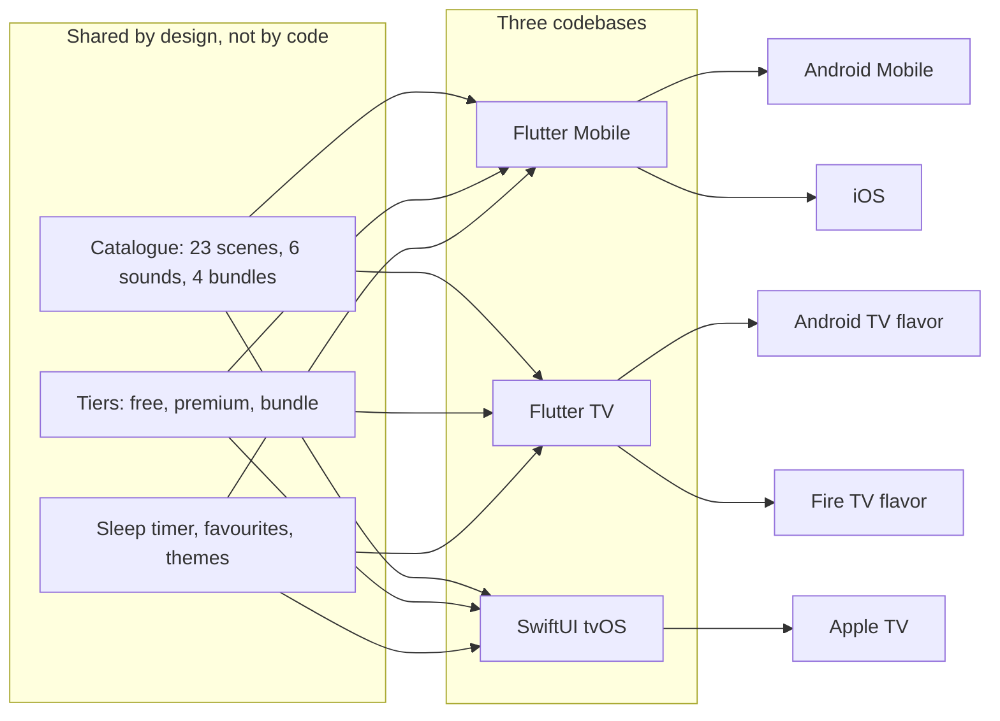

# Platform Engineering

Tranquil is built for five platforms from three production projects. This document records what was verified for each platform, what is shared, and where Mobile, Android TV, Fire TV and Apple TV differ by design. Statements come from the production manifests, build files and code, plus the two store listings supplied.

<table>
  <tr>
    <td align="center"> <b>Mobile</b>: real screenshot (landscape playback)</td>
    <td align="center"> <b>Android TV</b>: banner artwork (not a screenshot)</td>
    <td align="center"> <b>Apple TV</b>: top-shelf artwork (not a screenshot)</td>
  </tr>
</table>

## 1. Verification of the five platforms

The platform list was supplied as an expectation and checked rather than trusted.

| Platform | Result | Evidence |
|---|---|---|
| **Android Mobile** | Verified as a build target; store listing unverified | The Mobile Flutter project has an Android module with a phone launcher, an audio-service foreground service of type media playback, a notification permission and a Play Billing bridge. Mobile screenshots show Play billing text. The Android application ID is the same as the Android TV app's, and the Google Play listing supplied describes an Android TV app, so nothing here shows where the phone build is distributed |
| **iOS** | Verified | The same Mobile project has an iOS target with iPhone and iPad device families, an iOS 15 deployment target, a background-audio mode, a privacy manifest and a tracking-permission string. The App Store listing shows iPhone and iPad compatibility |
| **Android TV** | Verified | The TV project's `androidtv` flavor declares the Leanback feature as required, touchscreen as not required, a Leanback launcher category, a launcher banner and landscape orientation. The Google Play listing is titled "Tranquil: Sleep & Relax TV" and describes "Built Specifically for Android TV" |
| **Fire TV** | Verified as a build target; store listing unverified | The TV project's `firetv` flavor has its own application ID, a Leanback-only launcher, an Amazon Appstore SDK dependency, an Amazon purchase-response receiver, package-visibility entries for the Amazon store clients, and its own banner. No Amazon listing was supplied |
| **Apple TV** | Verified | A separate native SwiftUI project targets tvOS 17.0 with the Apple TV device family and a brand-asset catalogue with top-shelf images. Its bundle identifier matches the iOS app's, which fits a single App Store record. The App Store listing shows Apple TV compatibility (tvOS 17 or later) and a dedicated Apple TV screenshot set |

The App Store listing also shows compatibility entries for iPod touch, Mac with Apple silicon and Apple Vision. These describe the iOS binary on other Apple hardware and are not separate engineering targets, so this showcase does not claim them.

## 2. Shared and platform-specific

**Shared across the Flutter apps.** `provider` state, the models, the catalogue lists, the bundle definitions, the video pipeline structure (fallback clip, catalogue lookup, download queue, prefetch) and the persistence approach.

**Shared across Mobile, Android TV and Apple TV by intent.** The catalogue and tiers, the five themes, the bundle membership, the one-subscription-plus-unlocks model, the sleep-timer concept and the favourites feature. There is no shared package; each project carries its own copy, and they can drift.

**Specific to Mobile.** Background audio and the media session, interruption handling, push notifications, ad mediation with remote kill switches, an ads-first startup gate, localisation, an analytics validation layer and iOS tracking permission.

**Specific to the TV Flutter project.** Focus widgets, an overscan-safe wrapper, TV analytics throttling, scheduled moods, a native TV-sleep call, store flavors and two billing managers.

**Specific to Apple TV.** The native focus engine, StoreKit 2, a dual-player crossfade and a remote-press capture bridge.

## 3. Input, focus and layout

| Concern | Mobile | Android TV and Fire TV | Apple TV |
|---|---|---|---|
| Primary input | Touch | Remote D-pad, select, back, media keys | Siri Remote swipe and click, menu |
| Focus model | Not used | Flutter focus nodes and traversal; focusable wrapper widgets | Native SwiftUI focus with `focusSection` groups and default-focus hints |
| Activation keys | Tap | Select, enter, numpad enter, space | Click |
| Focus feedback | Ripples and pressed states | Scale and border on focus, accent colours | Scale, accent border and glow; the system plate is disabled |
| Screen edges | Edge-to-edge with safe areas | A unit-tested 5 percent overscan-safe wrapper exists; the screens inspected set their own fixed padding instead of using it | Fixed layout padding; no overscan inset |
| Scrolling | Touch scrolling | Scroll-into-view on focus, skipped when the card is already visible | Native focus scrolling |
| Orientation | Portrait app, landscape playback | Landscape | Landscape |
| Navigation | Five-tab shell with a mini player | Home rows, playback, settings pages | Home rows, playback, settings pages |

### Android TV and Fire TV remote handling

- The TV activity intercepts media play, pause and play-pause keys that the Flutter embedding does not forward and re-injects them as a select event, so the focused playback control handles them.
- A shared set of key helpers recognises directional keys, select-like keys and back-like keys, so every focusable widget activates the same way.
- Focus, select and directional events feed analytics through a guard that drops repeats of the same event within 350 ms and keeps changes of direction.
- Unit tests cover the focus helpers, the TV button and the overscan-safe widget.

### Apple TV remote handling

- The home, playback and settings screens use native focus. System focus effects are disabled in favour of a custom scale, border and glow so it matches the Android design.
- While a video is playing and the controls are hidden, the system player view would take remote focus. A small UIKit controller wrapped for SwiftUI becomes first responder and reports any remote press so the controls can reappear.
- Playback controls and the sleep-timer prompt are grouped into focus sections, with a preferred default focus on the play button and prompt actions.

## 4. Audio behaviour by platform

| Behaviour | Mobile | Android TV and Fire TV | Apple TV |
|---|---|---|---|
| Player | One shared player bridged to an OS media session | A player per item, no media session | `AVPlayer` for audio, a pair of muted players for video |
| Background playback | Android foreground service of type media playback; iOS background-audio mode | Not implemented; playback is tied to the screen | No audio-session configuration in code |
| Lock-screen and notification controls | Previous, play or pause, next; skip routes to the next accessible sound | Not applicable | Not applicable |
| Interruptions | Pause when the OS takes audio focus; resume only if the user did not pause | No handler in the Dart code | No handler in the code |
| Headphones unplugged | Pauses | Not applicable | Not applicable |
| Loop | Loop-one on the player | Loop-one on the player | Seek to start on end of item |
| Volume | One volume plus mute; a default volume is saved | One volume plus mute; a default volume is saved | One volume plus mute; the volume is saved as the default |
| Mixing | One audio source at a time | One audio source at a time | One audio source at a time |
| Scene audio | Scene video is muted; audio comes from the Sounds tab | Scene video is muted | Scene video is muted and a scene also starts an audio loop from a URL |

There is no multi-track mixer, no per-track volume and no fade-out of audio at the end of a sleep timer in any of the three projects.

## 5. Sleep timer by platform

| | Mobile | Android TV | Apple TV |
|---|---|---|---|
| Presets | Off, 15, 30, 60, 90 minutes | Off, 15, 30, 45, 60, 90, 120 minutes | 15 to 90 minutes on the player, up to 120 in settings |
| Default | Saved in settings | Saved, with a prompt after choosing one | Saved, with a prompt after choosing one |
| At expiry | Pause, dim the screen to near black, leave the app | Pause, then ask the OS to put the TV to sleep, falling back to leaving the app | Pause, fade to black, return to the previous screen |
| Cancel | Selecting Off | Selecting Off | Cancel action |

The sleep call on Android TV uses a hidden platform method that many devices block, which is why the Dart layer has an exit fallback. Apple TV offers no equivalent API, so the app fades out instead.

## 6. Billing, ads and telemetry by platform

| | Mobile | Android TV | Fire TV | Apple TV |
|---|---|---|---|---|
| Billing | Play Billing through a Kotlin bridge; StoreKit through the plugin | Play Billing through a Kotlin manager | Amazon Appstore SDK through a Kotlin manager | StoreKit 2 |
| Billing dependency scope | App-wide | Google flavor only | Amazon flavor only | Native |
| Ads | Mediation SDK with four network adapters | Unity Ads | None | None |
| Consent | iOS tracking permission; Android treated as allowed | Marked not required, with a release to-do for EEA consent | Marked not required | Tracking permission requested at launch |
| Firebase | Analytics, Crashlytics, Messaging, Performance, Firestore | Analytics, Crashlytics | Not initialised | Not integrated |
| Remote config | Firestore document with seven ad placement switches | None | None | None |
| Notifications | Push and local | None | None | None |

## 7. Native code

| Project | Native layer |
|---|---|
| Mobile (Android) | Four Kotlin files: main activity, splash activity, application class, Play Billing manager; a forked ad-mediation plugin with Java and Objective-C |
| Mobile (iOS) | Swift app and scene delegates, a native splash view controller |
| TV (Android TV) | Kotlin main activity with billing and sleep channels and media-key forwarding, plus a Play Billing manager |
| TV (Fire TV) | Kotlin launcher activity registering the Amazon listener in `onCreate`, plus an Amazon billing manager and a main-activity stub |
| Apple TV | The whole app is Swift; UIKit appears only in the player container and the press-capture bridge |

## 8. Performance and resource handling

- **Mobile launch.** A splash app renders before any initialisation. Firebase start is time-boxed to 10 seconds because an unbounded stall was seen on network-filtered devices, and the ad gate is capped.
- **TV builds.** The application requests a large heap and the Android TV build is limited to two ARM ABIs, which removes emulator libraries from release packages.
- **Release builds.** R8 shrinking and resource shrinking are enabled on the Flutter apps' Android release builds.
- **Video storage.** On Mobile, clips are cached in app storage and the scene start-up flow clears previously downloaded clips before fetching the new category.
- **Apple TV video.** Old players are emptied after the crossfade, and the display is prevented from sleeping during playback.

## 9. What was not verified

- Whether the Android Mobile build is published and where.
- Whether a Fire TV listing exists.
- Any runtime measurement. No performance, retention, download or rating figures are claimed.
- TV screenshots. None exist, so TV visuals here are artwork only.
