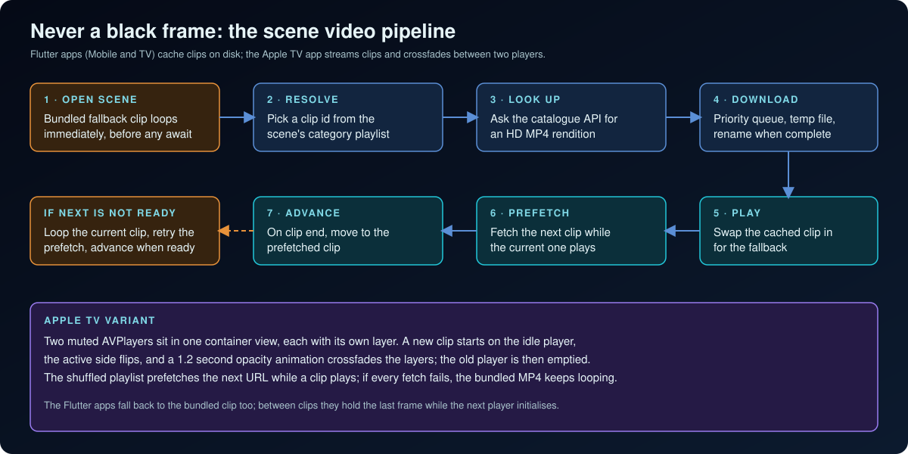

# Technical Case Study

Tranquil: Sleep & Relax is a relaxation app of looping ambient scenes and sounds. This case study covers the engineering of delivering it on five platforms: Android Mobile, iOS, Android TV, Fire TV and Apple TV. Everything below was read from the production projects (manifests, build files, code, tests) and from the two store listings supplied. No usage, rating or revenue figures are claimed.

<table>
  <tr>
    <td align="center"> Real Mobile screenshot</td>
    <td align="center"> Real Mobile screenshot</td>
    <td align="center"> Fire TV banner artwork (not a screenshot)</td>
  </tr>
</table>

## 1. Goal and constraints

A viewer wants calm, not features. That sets the product bar: playback must start fast, never show an empty screen, run for hours, and be controllable from a bed (phone) or a sofa (remote). The platforms impose very different rules on how that is achieved.

| Constraint | Consequence |
|---|---|
| Phones background and kill apps; TVs mostly do not | Mobile needs a media session, foreground service and interruption handling; TV apps are foreground-only |
| A remote cannot point | TV needs explicit focus design, key handling and a visible focus state |
| Amazon rejects Play Billing references and phone launchers | Fire TV needs its own flavor, manifest and billing manager |
| Apple TV has a native focus engine and no ad SDK in this app | A separate native project fits better than a Flutter port |
| Scene video is large and remote | A download, cache and fallback pipeline is required |

## 2. Platform verification

Platforms were checked against production evidence, not assumed.

| Platform | Result | Key evidence |
|---|---|---|
| Android Mobile | Verified build target; listing unverified | Android module in the Mobile project with phone launcher, media-playback foreground service, Play Billing bridge |
| iOS | Verified | iPhone and iPad device family, iOS 15 minimum, background-audio mode; App Store listing shows iPhone and iPad |
| Android TV | Verified | Leanback launcher, banner, touchscreen optional, landscape; Google Play listing "Tranquil: Sleep & Relax TV" |
| Fire TV | Verified build target; listing unverified | `firetv` flavor with its own application ID, Leanback-only launcher, Amazon IAP receiver and banner |
| Apple TV | Verified | Separate SwiftUI project, tvOS 17 target; App Store listing shows Apple TV (tvOS 17 or later) and a TV screenshot set |

Details: [PLATFORM_ENGINEERING.md](PLATFORM_ENGINEERING.md).

## 3. Structure: three codebases

The split follows the real differences rather than a goal of maximum reuse.

- **Flutter Mobile project.** Android Mobile and iOS. Portrait, touch, background audio, notifications, ad mediation, 20 languages.
- **Flutter TV project.** Android TV and Fire TV through two Gradle flavors and a compile-time store value. Landscape, remote-only.
- **SwiftUI tvOS project.** Apple TV with the native focus engine, StoreKit 2 and AVFoundation.

The product design is shared in intent: the same 23 scenes (8 free, 15 premium), 6 sounds, 4 bundles, five themes, sleep-timer concept and one-subscription-plus-unlocks model. There is no shared package, so each copy can drift; the trade-off is discussed in [ENGINEERING_CHALLENGES.md](ENGINEERING_CHALLENGES.md).

  

## 4. Scene video pipeline

Scene video comes from a stock-footage API, so the app treats the network as unreliable.

1. A bundled clip loops the moment a scene opens.
2. The scene category maps to a playlist of clip IDs embedded in the app.
3. The API is asked for an HD MP4; a priority queue downloads it to a temporary file that is renamed when complete, so a half-written file is never played.
4. The next clip is prefetched while the current one plays; if it is not ready at the end of a clip, the current clip loops and the prefetch retries.
5. On Mobile, the outgoing video controller is kept until the next one initialises, so the last frame stays visible.
6. On Apple TV, two muted players are crossfaded for 1.2 seconds, and the bundled clip remains the fallback if every fetch fails.

  

## 5. Audio

- **Sounds** are six bundled MP3 loops. Scene video is muted; scenes do not carry their own audio on the Flutter apps.
- **Mobile** routes one shared player through an audio handler bridged to the OS media session. It publishes previous, play or pause and next controls, pauses on interruptions and headphone unplug, and resumes after an interruption only if the user had not paused. Lock-screen skip buttons go through entitlement-aware navigation.
- **TV** creates a player per item with no media session, since playback is tied to the screen.
- **Apple TV** plays audio with `AVPlayer`; the code contains no audio-session setup, although a project document describes one.
- There is **no mixing of simultaneous tracks, no per-track volume and no audio fade-out** in any project. Volume is a single level plus mute, with a saved default.

## 6. Sleep timer

All three projects run a one-second ticker for the countdown badge and a single timer for expiry. The end action is platform-specific: Mobile pauses, dims to near black and leaves the app; Android TV pauses and tries a native sleep call with a fallback exit; Apple TV pauses, fades to black and returns to the previous screen. Mobile cancels the timer when the app is detached.

## 7. Entitlements and monetisation

- One monthly subscription, 14 one-time products and four bundles, defined once per project.
- Subscription status comes from the store only; one-time purchases never set it.
- Once entitlements have synced, access checks consult the store, not a local copy.
- Mobile adds a rewarded ad for one hour of access with a stored expiry and an in-memory cache so lock chips refresh immediately.
- Purchase buttons check connectivity first.
- TV billing sits behind one interface with a Play Billing manager and an Amazon manager; Fire TV registers its Amazon listener in `onCreate` with a live activity context, which the Amazon flow requires.

## 8. Ads, consent and remote configuration

The Mobile ad flow is gated by a startup coordinator: premium users and offline launches skip it, the whole gate is capped at 22 seconds on Android and 26 on iOS, a two-second splash minimum is enforced and the result resolves exactly once. Seven placements have remote on/off switches in one Firestore document. **Defaults are fail-open for ads**: every switch starts on, and a missing document, missing field, wrong type, slow first read or listener error leaves it on. The config can only turn placements off.

The Google TV build uses Unity Ads; Fire TV and Apple TV have none. The Android TV consent gate marks consent not required, with an explicit release to-do for EEA consent; this showcase therefore makes no consent-compliance claim for that build.

## 9. Input and focus on TV

Flutter TV screens use shared focus helpers (directional, select-like and back-like key sets), focus-aware buttons and scroll-into-view that skips when a card is already visible. The media-key forwarding in the Android TV activity turns remote play/pause into a select event. An overscan-safe wrapper widget exists and is unit tested. Focus and remote events reach analytics through a guard with a 350 ms repeat window. Apple TV uses focus sections, default-focus hints and a UIKit press bridge so the controls can reappear while video holds focus.

## 10. Persistence, performance and release

- **Persistence.** Local only: `shared_preferences` on Flutter, `UserDefaults` on Apple TV, cached clips on disk on Mobile. No accounts or user database.
- **Launch.** Mobile shows a splash first and time-boxes Firebase start. The TV app shows a splash then starts the full app.
- **Release.** R8 shrinking and resource shrinking on Android release builds; ABI filters trim packages; the TV project has a scripted release audit that is itself covered by a test.
- **Tests.** The TV Flutter project has 10 Dart test files (focus, button, safe area, billing mapping, store config, consent, analytics, a release-audit contract) and Maestro and Appium device flows for Android TV, Fire TV, Android phone and tablet, iPhone and iPad. The Mobile project has 2 Dart test files plus an iOS placeholder. The Apple TV project has no test files.

## 11. Limits of this study

- No runtime measurements; behaviour is read from code.
- The Android Mobile and Fire TV store listings were not supplied.
- No TV screenshots exist; TV visuals are artwork only.
